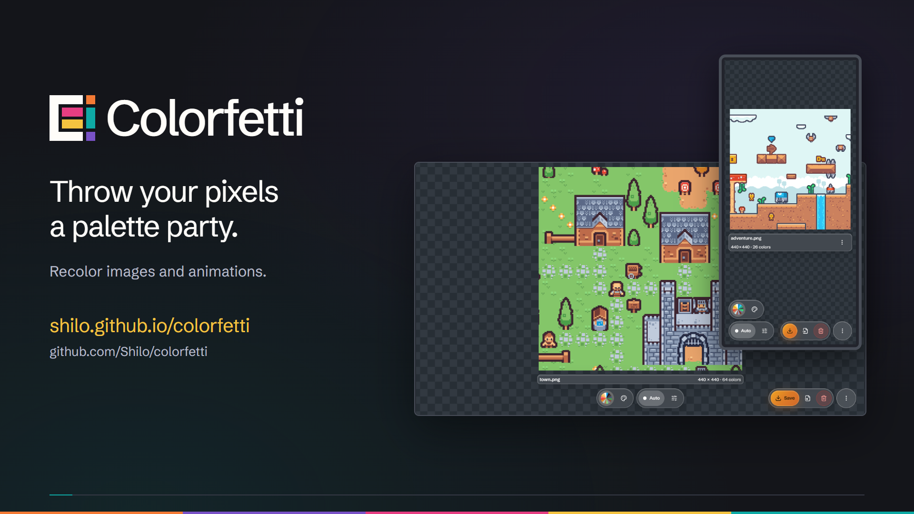

<picture>
  <source media="(prefers-color-scheme: dark)" srcset="src/assets/logo-dark.svg">
  <source media="(prefers-color-scheme: light)" srcset="src/assets/logo.svg">
  
</picture>

# Colorfetti

Throw your pixels a palette party. Recolor images and animations.

Colorfetti is a browser-based palette recoloring tool for images, sprites and animated
GIFs. Generate a palette from your artwork, choose a preset, or import and edit your
own. Optional 1-bit styles offer two-color effects. Images stay on your device.

**[Open Colorfetti](https://shilo.github.io/colorfetti/)**

**[Watch trailer](https://shilo.github.io/colorfetti/colorfetti-trailer.mp4)**

[](https://shilo.github.io/colorfetti/colorfetti-trailer.mp4)

## Features

- Add any number of images by drag and drop, file picker or paste. Web and Discord image drops work when the host allows access, including animated GIFs.
- Start with Auto colors generated from your images and GIFs, choose from nine curated full-palette presets, or use a named local palette library. Full palettes support 1–256 unique opaque RGB colors. One editor lets you import images or palette files, paste hex colors, or add colors manually, then review and save. Drop an image or Aseprite file from your device into the editor. Discord and web URL drops require the host to allow browser access; otherwise save the attachment and import the local file. Files support HEX/TXT, legacy RGB GPL, JASC-PAL and Aseprite embedded palettes.
- Match colors using Oklab (default) or RGB. **Max colors** optionally limits each image to a smaller subset of the shared palette. Optional **Cleanup** merges isolated pixels and can remove small details; it defaults to Off. A separate opacity cut appears when needed.
- An immersive checker canvas with grouped floating glass controls and readable image actions/labels.
- Compare with the original: click the palette- or style-named button, hold a tile, or hold Space.
- Save PNGs and animated GIFs at original size, or all images as a ZIP. Full palette GIFs allow up to 256 used colors, including transparency; incompatible exports offer an explicitly edited palette copy.
- Copy an image to the clipboard with its Copy button (on phones, from its Share button), or the first one with Ctrl+C.
- Responsive desktop, iOS and Android interface, with app installation where the browser supports it.

## Using palettes

Fresh visits start in **Palette** with **Auto**, which generates a shared palette from
your images and GIF frames. Choose a curated preset for a consistent look, or import
and save your own colors.

Saved palettes stay on this browser/device. Reset settings keeps them unless **Delete saved palettes** is selected. The download icon beside Close exports a HEX backup when colors are available. Shared color review sits above the editor's three input methods. The new palette workflows have browser automation coverage; physical-phone and Safari validation remain outstanding.

Aseprite `.ase` / `.aseprite` import reads the first frame's embedded palette in index order, using its stored RGB values without applying the artwork's color profile. It does not render the sprite. Its parser downloads only when an Aseprite file is selected; other imports use their existing paths. Export a color-managed PNG first if you want colors from the rendered artwork instead.

Open **Palette** to choose colors. The import icon accepts an image, palette file or pasted colors; the edit icon opens color review. **Nearest** offers **Max colors**, **Matching: Oklab / RGB**, **Cleanup: Off / On**, and Opacity cut when needed. The slider and number run from 2 to the active palette's color count; a higher remembered limit returns with a larger palette. One-color palettes disable both limit inputs. **All** restores unrestricted matching, places the slider at the palette maximum and shows that count in the field. Slider edits apply after a pause or release; number edits apply when finished. Settings are remembered. Oklab compares perceived differences; RGB compares channel values. Neither guarantees the best-looking result for every palette. A limit can merge details; sprites use different subsets, while GIF frames share one stable subset. Large palettes show up to sixteen representative colors in their thumbnail. Help in More lists the controls available in the current mode. See [palettes.md](docs/palettes.md) for details.

Max colors previews update after a short slider pause or release, keeping the previous
preview visible while recalculating. Number edits apply when finished.

**Cleanup: Off / On** in Nearest optionally merges isolated pixels with compatible
neighbors, limits added color error and preserves exact colors in the active palette.
It can still remove small details, so Off is the default. GIFs keep a change
only where every frame agrees on the nearest color and replacement. Moving noise can
remain. Cleanup uses the same full-source decisions for previews and exports; it retains
the palette, color cap and transparency. See the [research and limitations](docs/research/2026-10-12-one-pixel-cleanup.md).

## Optional 1-bit styles

Switch to **1-bit** in the Palette panel for two-color effects. Choose a preset pair
or your own colors, swap them, or set either to None for transparency. Eleven styles
include Cutout, Stencil, Icon, outlines and dithering, with a threshold and settings
for each style. See [styles.md](docs/styles.md) for the full guide.

## Development

```bash
npm install
npm run dev
```

`npm test` runs the unit tests, `npm run build` writes the site to `dist/`.

`npm run icons` regenerates the production favicon and app icons from [the approved logo](src/assets/logo.svg). [Brand guide](docs/research/2026-10-13-colorfetti-identity.md).

`node bench/palette-qa.mjs dist` checks the built app through real controls, including independently decoded palette exports, cross-tab storage changes, GIF comparison during pending conversion, and all twelve 1-bit color pairs with all eleven styles. Set `BASE_REF` to the pre-feature Git revision when running this compatibility check after committing the feature.

Built with Svelte 5 and Vite. Every push to `main` is deployed to GitHub Pages by [deploy.yml](.github/workflows/deploy.yml).

The full design is in [docs/superpowers/specs/2026-10-06-colorfetti-app-design.md](docs/superpowers/specs/2026-10-06-colorfetti-app-design.md).

## Deferred work

[MP4 import feasibility and deferred task](docs/research/2026-10-11-mp4-support.md) records the tested browser-decoding approach, memory and compatibility limits, and proposed scope for MP4 import with GIF export. MP4 app support is not implemented; MP4 export is deferred separately.

Trailer video music from **[Cinematic Trailer Music - Collection](https://gregor-quendel.itch.io/cinematic-trailer-music-collection)** by [Gregor Quendel](https://gregor-quendel.itch.io/) (CC BY-NC 4.0). Repeated excerpts, with volume adjustment, crossfade and fades.
