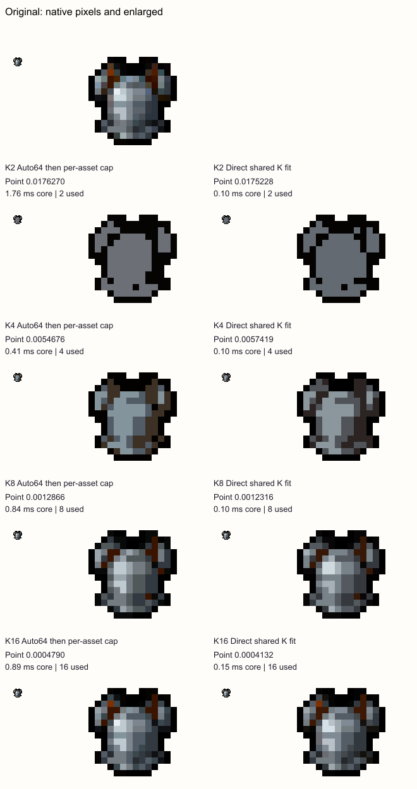
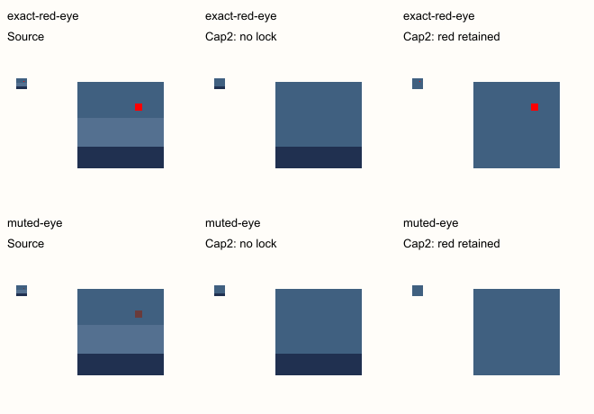

# Auto fitting, color locks and quick budgets

Keep the current Auto workflow for this release. Fitting directly to a requested
color count is promising, but this bounded experiment does not justify silently
replacing Max colors. It sometimes worsens both error and useful material cues,
and fitting one small wall palette changes the meaning of the existing per-image
cap. Color locks need a separate, explicit contract before implementation. Defer
another permanent row of 2/4/8/16 buttons while the existing number field covers
those values.

This is offline research only. It makes no service calls and changes no production
conversion, settings or UI code.

## Reproducible experiment

Run `node bench/palette-fitting-spike/run.mjs`. The
[results](../../bench/palette-fitting-spike/results.json) retain palettes, used
counts, point error, all timing samples, source/core hashes and output filenames.
The [comparison index](../../bench/palette-fitting-spike/index.html) links native
and nearest-neighbor enlarged output views.

The experiment reuses the current generation core through an in-memory module,
changing only its capacity constant from 64 to 2, 4, 8 or 16. It does not copy or
modify shipping files. Original source validation, bounded histograms, six fitting
refinements, equal nonempty asset mass and frame-duration weighting remain intact.
This isolates the requested capacity; it does not establish that the existing
seeding/refinement heuristic is optimal at smaller capacities.

All matching uses Oklab, Opacity cut 128, Dithering Off and Cleanup Off. Error is mean
squared point distance in Oklab over visible source pixels, duration-weighted within
a GIF and averaged equally across assets for a wall. It is not an artistic-quality
or semantic-detail score. Quantizer results were written as research PNGs, rather
than passed through the application's Save UI. Dimensions, thresholded alpha,
palette membership and color-count bounds are asserted for every result.

The six scopes are:

- A [64×64 original inventory sheet](../../bench/palette-fitting-spike/sprite-source.png).
- A [16×16 original breastplate](../../bench/palette-fitting-spike/armor-source.png).
- A [64×32 grayscale ramp](../../bench/palette-fitting-spike/ramp-source.png).
- A [64×64 RGB cube](../../bench/palette-fitting-spike/cube-source.png).
- One wall containing all four, with equal asset mass.
- A [three-frame GIF](../../bench/palette-fitting-spike/duration-weighted-source.gif)
  derived from the breastplate, with delays 40/160/80 ms. The middle frame adjusts
  the red channel of blue-dominant body pixels. GIF decoding independently verifies
  its source pixels, delays and loop before fitting.

Each scope is tested at four counts: 24 scope/count cases, with three methods each.
The methods are current Auto64 followed by separate per-asset caps; direct fitting
of one shared K-color palette; and a control selecting one shared K-color subset
from Auto64. The last control retains the same wall scope and count as direct
fitting, without confusing it with current per-asset behavior.

## Smaller direct fits help often, with concrete regressions

For the four individual sources and the GIF, direct fitting has lower point error
in 16 of 20 cases. It improves the RGB cube at every tested count and the inventory
sheet at every count. The improvements range from effectively negligible on the
two-color ramp to 15.2% on the 16-color cube. It is not uniformly better:

| Equal-scope case | Auto64 then cap | Direct K fit | Change in point error |
| --- | ---: | ---: | ---: |
| Breastplate, K4 | 0.0054676 | 0.0057419 | 5.0% worse |
| Grayscale ramp, K4 | 0.0048994 | 0.0053423 | 9.0% worse |
| Grayscale ramp, K8 | 0.0013503 | 0.0014911 | 10.4% worse |
| Duration-weighted GIF, K4 | 0.0052578 | 0.0055907 | 6.3% worse |
| Inventory sheet, K16 | 0.0023047 | 0.0021463 | 6.9% better |
| RGB cube, K16 | 0.0079046 | 0.0067042 | 15.2% better |

Native-size and enlarged inspections give useful counterexamples to a single
aggregate score. At K4 the direct breastplate fit loses the warmer brown material
accents and produces a flatter gray result; the current subset retains those accents.
At K8 the direct inventory fit gives the small plant a clearer green, while the
current result is more muted, despite only a 0.7% average-error difference. Neither
algorithm understands that a brown rim or a green leaf is an important material cue.

A concrete next algorithm candidate is to initialize refinement from the current
selected subset, then compare the fitted candidate against that subset using the
same captured source and objective. Retaining the baseline when its measured error
is lower would reject the four observed point-error regressions. This guard is a
proposal, not a tested implementation: extra fitting/source passes have a cost,
and a lower point error still cannot guarantee preservation of a rare material cue.

The [inventory figure](../../bench/palette-fitting-spike/sprite-comparison.png)
provides the corresponding sheet comparison. Source and result pixels are displayed
without smoothing. These are a small set of visual observations, not a blind user
study or a general preference ranking.

## A shared wall budget is a different feature

The existing cap selects at most K colors **per asset** from the shared 64-color
palette. A directly fitted K-color wall palette permits only K colors across the
entire wall. Those constraints are substantially different:

| K | Current wall's actual RGB union | Direct shared fit's union | Current mean error | Direct mean error | Shared-subset control error |
| --- | ---: | ---: | ---: | ---: | ---: |
| 2 | 8 | 2 | 0.0234316 | 0.0296491 | 0.0304866 |
| 4 | 15 | 4 | 0.0104443 | 0.0144135 | 0.0154154 |
| 8 | 27 | 8 | 0.0050838 | 0.0084937 | 0.0086030 |
| 16 | 50 | 16 | 0.0028164 | 0.0047836 | 0.0044298 |

The direct shared fit beats the equally constrained shared-subset control at K2,
K4 and K8, but loses at K16. It also gives worse error than current per-asset caps
at every K while using far fewer colors globally. That is a scope tradeoff, not
evidence that the same cap implementation regressed.

If implemented later, expose a separate **Auto palette size** or an explicit
**shared collection budget**, preserving the existing cap's per-asset meaning.
Changing such a size must regenerate Auto and participate in source signatures,
worker protocols, cancellation, snapshots and caches. It must retain one fitted
palette across the entire GIF, with original delays. Adding an asset can recolor
every existing asset; that consequence needs to remain visible and intentional.

## Core costs suggest potential, not a phone speed guarantee

Three sequential core runs were recorded per phase. Timings include cooperative
scheduler turns but exclude decoding, worker transfer, UI work and cache hits.
The current pipeline column adds separately measured Auto64 and cap medians; it is
not a directly timed end-to-end application gesture.

| Case | Auto64 + cap median sum | Cap only, Auto already available | Direct K fit median |
| --- | ---: | ---: | ---: |
| Inventory, K8 | 4.63 ms | 2.45 ms | 0.65 ms |
| Breastplate, K4 | 0.41 ms | 0.35 ms | 0.10 ms |
| RGB cube, K8 | 40.60 ms | 14.72 ms | 4.17 ms |
| Four-asset wall, K8 | 49.87 ms | 21.21 ms | 6.44 ms |
| Duration-weighted GIF, K8 | 2.03 ms | 1.05 ms | 0.31 ms |

These small desktop Node measurements justify further investigation of direct
fitting. They do not establish browser/phone latency, frame rate, worker memory or
a cache-aware speedup. Direct fitting also makes changing a count a regeneration
operation, whereas today's Auto palette survives cap edits. Larger sources,
prolonged interaction and physical-device measurements remain required.

Decision: **defer shipping direct fitting**. First improve or compare the small-K
seed/refinement strategy, retain the K4/K8 regressions as fixtures, define shared
versus per-asset scope, and test semantic-detail counterexamples and real phone
interactions. Do not sell the lower mean error in selected cases as an across-the-
board improvement.

## A color lock preserves availability, not necessarily a visible detail

A 16×16 synthetic fixture contains 144 visible pixels, including one exact red
eye among blue-gray shading. The four-color target is fixed. At cap two the current
subset discards red. A bounded research-only enumeration reserves red and chooses
the better remaining target color; this is a tiny counterexample, not an implemented
general locked-subset algorithm.

| Source eye | Red available in cap-two subset? | Red pixels actually output | Point error |
| --- | --- | ---: | ---: |
| Exact `#ff0000`, current cap | No | 0 | 0.0019507 |
| Exact `#ff0000`, reserved red | Yes | 1 | 0.0080831 |
| Muted `#6a3b3b`, current cap | No | 0 | 0.0012600 |
| Muted `#6a3b3b`, reserved red | Yes | 0 | 0.0082136 |

Reserving exact red preserves the one-pixel eye, at roughly four times the average
point error because broad body shading loses its second color. With the muted eye,
red remains available but nearest matching never chooses it. A locked palette color
therefore cannot promise that a feature will be painted that color. Forcing actual
use would require a separate source-color mapping override or a spatial edit.

A future initial lock contract should mean **keep this target RGB in every selected
subset**. It should not force arbitrary pixels or claim semantic preservation.
Exact source RGB membership already provides the useful exact-red behavior once
that RGB survives the cap. If locked-color count exceeds the requested cap, block
the conflicting choice with explicit unlock/raise-cap actions; never silently drop
locks, exceed the requested budget or reduce the number of other locks. Lock RGBs
must belong to the active palette and retire when a palette edit removes them.
Opacity, Cleanup, dithering and snapshot behavior also need explicit tests before
shipping.

Decision: **defer implementation of locks**, retaining both tiny counterexamples
as requirements. The membership-versus-use distinction and cap conflicts need to be
resolved in the product wording before building controls.

## Quick 2/4/8/16 choices

Those budgets are useful comparison points, but the current committed number field
already selects them precisely and retains the preference across palettes. A new
always-visible row would consume another roughly 44–50px plus spacing in a settings
panel that already scrolls on a short phone landscape screen. This experiment
contains no evidence that four more permanent controls improve the workflow enough
to justify that cost.

Decision: **keep the existing field and All button**. If repeated testing reveals
budget entry is a real bottleneck, try contextual choices attached to the existing
field, then measure 320px portrait and short-landscape reachability, typing steps
and abandoned-gesture cancellation. Do not overload pattern sizes or introduce a
second ambiguous row of bare numbers.
