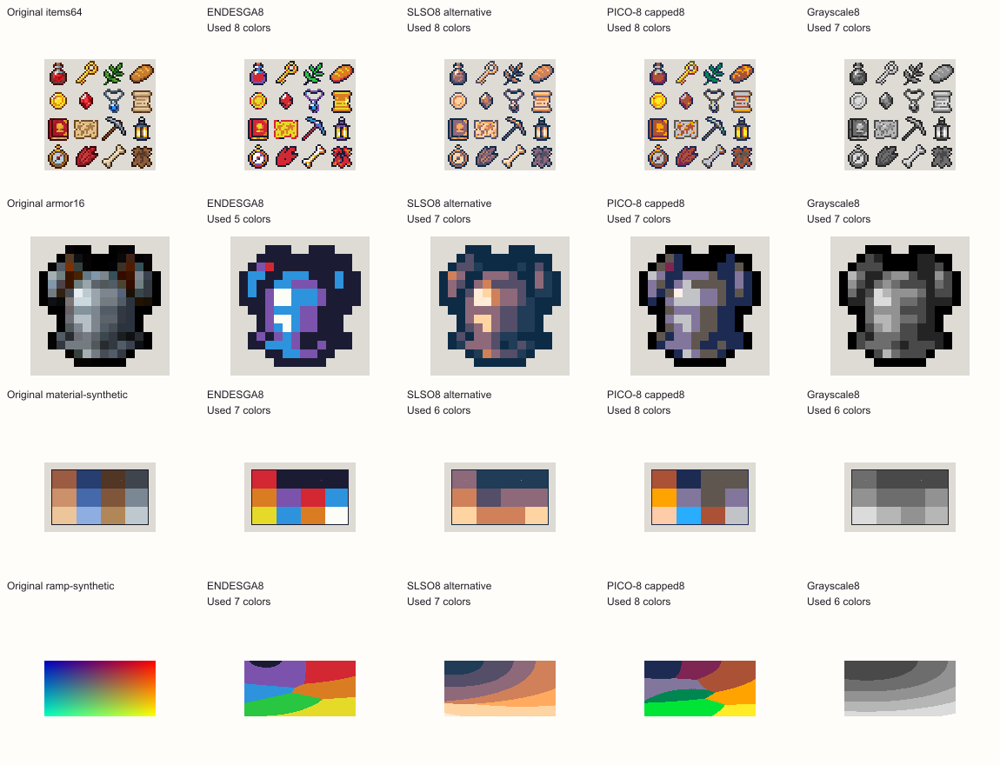
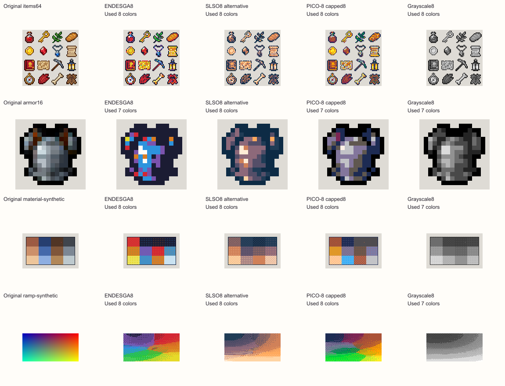
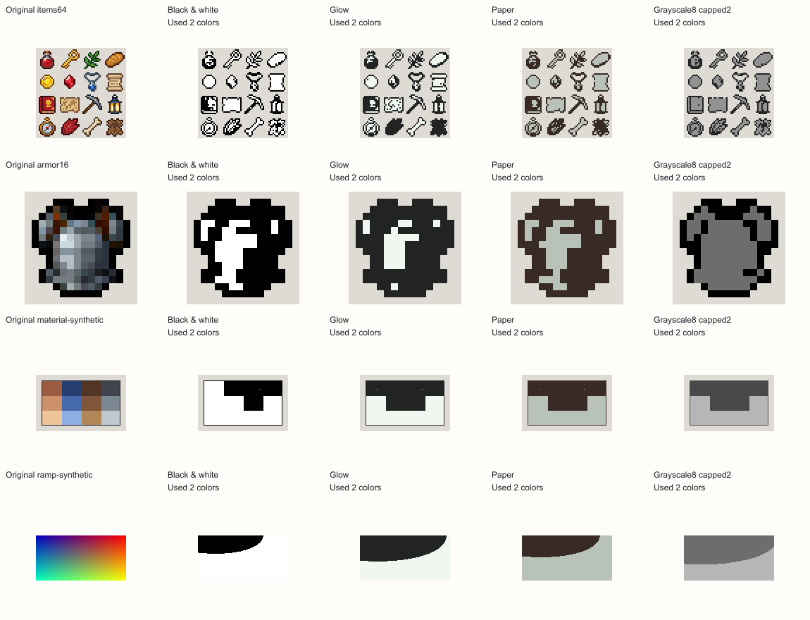

# Curated palette selection

October 14, 2026. Decision: add **Black & white** and **ENDESGA 8**, retaining the existing targets, their stable identities, Auto as the fresh default and ENDESGA32 as the curated fallback. The benefit is easier access to two distinct fixed targets. This study does not establish that the additions produce better recoloring in general.

## Selection by useful coverage

The previous full-palette collection contained nine targets: Resurrect64, ENDESGA32, PICO-8, DawnBringer16, Grayscale8, Ice Cream GB, Game Boy green, Glow and Paper. The separate 1-bit collection has twelve color pairs, but those belong to a different conversion workflow. In particular, 1-bit Mono did not make pure black/white available in Palette mode.

The [public reducer catalog](https://www.pixellab.ai/create?tool=reduce_colors) observed during the review listed seventeen choices. Its breadth is useful context, rather than a requirement to reproduce the whole catalog. Displayed names/counts establish discovery choices; they do not independently establish the exact RGB values used behind every website choice.

| Public catalog choices and displayed counts | Existing useful coverage | Decision |
|---|---|---|
| Black/white2 | Glow2 uses near-black/off-white; Paper2 uses brown/gray. Grayscale8 capped2 chooses source-dependent grays. | Add exact black/white endpoints in Palette. |
| Game Boy4, CGA4, Hollow4 | Warm Ice Cream GB4, green Game Boy4 and grayscale already offer compact looks. [Hollow](https://lospec.com/palette-list/hollow) is a published cool four-color interpretation. | Keep specialized alternatives importable; no third compact look in this batch. |
| PICO-8 16, DawnBringer16, Sweetie16 | The first two are already present. [Sweetie16](https://lospec.com/palette-list/sweetie-16) is another colorful general-purpose target; its published swatches do not establish a missing pastel-only category. | Do not add another sixteen-color choice without a demonstrated distinct use. |
| ENDESGA32, DawnBringer32, AAP64, Resurrect64 | ENDESGA32 and Resurrect64 already cover larger authored targets and ramps. | Extra names/counts alone do not justify expanding the rail. |
| SLSO8, Oil6, Twilight5 | [SLSO8](https://lospec.com/palette-list/slso8) and [Oil6](https://lospec.com/palette-list/oil-6) are published monoramps; [Twilight5](https://lospec.com/palette-list/twilight-5) offers a sunset-derived cool/warm look. | Useful import alternatives. A monoramp is different from a broad-hue eight-color target. |
| NES55, Commodore64 16, ZX Spectrum15 | Specialized historical looks are already partly represented by the optional 1-bit pairs; full hardware sets would still be distinct targets. | Do not imply hardware accuracy from RGB labels or add them only to match catalog size. Exact interpretation would need separate verification. |

The observed seventeen do not include ENDESGA8. It is selected independently from the [published ENDESGA8 definition](https://lospec.com/palette-list/endesga-8): ENDESGA's eight colors, in published order, are `fdfdf8 d32734 da7d22 e6da29 28c641 2d93dd 7b53ad 1b1c33`. Its fixed red/orange/yellow/green/blue/purple range fills a distinct gap beside neutral Grayscale8. PICO-8 capped to eight remains competitive, but selects a different subset for different artwork. A fixed eight-entry target makes the same available colors explicit across a related collection.

Black & white is defined directly as opaque sRGB `#000000` and `#ffffff`. It shares RGB values with the optional 1-bit Mono pair while retaining Palette matching and dithering behavior. Its identity is not interchangeable with Glow, Paper or an automatically chosen pair of grays.

## Completed local quality comparison

The [reproducible local study](../../bench/palette-curation-spike/run.mjs), [measurements](../../bench/palette-curation-spike/results.json) and [native/enlarged gallery](../../bench/palette-curation-spike/index.html) use the real64px item sheet and16px armor already present in this repository, plus the original synthetic material sprite and chromatic ramp from the earlier preset experiment. Sources retain native pixels; no service calls or uploads occur.

Each of eight targets is converted with dithering Off and4×4 strength50: **64 conversions** total. Baselines include SLSO8, PICO-8 capped8, Grayscale8, Glow, Paper and Grayscale8 capped2. Cap selection is performed once per source before both dither variants. ENDESGA8 and Black & white retain their complete fixed target in both variants. Matching is Oklab, opacity cut128 and Cleanup Off. Independent decoding of every production PNG verifies binary-alpha classification, active-target membership and preservation of exact active RGB.

| Source | ENDESGA8 used Off / dither50 | Black & white used Off / dither50 | Important observation |
|---|---:|---:|---|
| Native item sheet64×64 | 8 / 8 | 2 / 2 | ENDESGA8 offers colorful small-item output; the pure two-color target offers a clear high-contrast alternative. |
| Native armor16×16 | 5 / 7 | 2 / 2 | ENDESGA8 shifts neutral armor to blue/purple; dithering adds bright flecks. Existing grayscale/PICO targets fit this source better. |
| Synthetic material sprite128×80 | 7 / 8 | 2 / 2 | ENDESGA8 separates five of six constructed role probes, while warm hues collide; these probes are not a readability score. |
| Synthetic chromatic ramp128×64 | 7 / 8 | 2 / 2 | Broad hue coverage distinguishes ENDESGA8 from neutral grayscale and the cool/warm monoramp. Dithering adds substantial texture. |

The negative armor result matters. Its ENDESGA8 Off point Oklab error is .025044, versus .006107 for PICO-8 capped8 and .003525 for Grayscale8. The synthetic ramp instead gives ENDESGA8 .013251 versus Grayscale8 .026233; PICO-8 capped8 remains slightly lower at .012383. These are per-visible-pixel sums of squared Oklab-axis differences. The nearest Oklab objective favors itself and does not determine artistic preference. Neither the new preset nor dithering should become an automatic correction or default from this evidence.

Grayscale8 capped2 selected `#242424/#929292` for the item sheet, `#000000/#6d6d6d` for armor, `#494949/#b6b6b6` for the material sprite and `#6d6d6d/#b6b6b6` for the ramp. That is useful fitting behavior, but it does not provide the requested fixed black/white endpoints. This is why the new two-color target is more than a name change.

## Acceptance gates and limits

Both additions pass the bounded gates: each fills a previously missing fixed-target workflow; each has exact independently reviewable RGB values; all64 conversions preserve alpha and active palette membership; authored exact target colors remain exact; and negative outcomes remain visible. Existing preset RGB values, IDs and relative order are retained. New entries stay in descending size groups: ENDESGA8 before Grayscale8, Black & white before Glow/Paper. No matching, generation, limiting or dither algorithm changes belong to this decision.

The study contains only four sources, Off and one enabled pattern/strength, and no artist preference trial, animation quality evaluation or mobile layout measurement. UI integration and device regression checks remain separate release work. These additions expand convenient choice; they do not promise higher fidelity, complete material preservation, universal readability or exactly eight used colors.

Reproduce with `node bench/palette-curation-spike/run.mjs`. The recorded results retain source PNG hashes and conversion-module hashes, palette order/credit, selected subsets, actual used counts, point errors and per-output checks. Existing primary snapshots preserve published ENDESGA8/SLSO8 swatches; reproduction is offline. Further catalog choices remain ordinary imports unless later evidence earns another curated entry.
