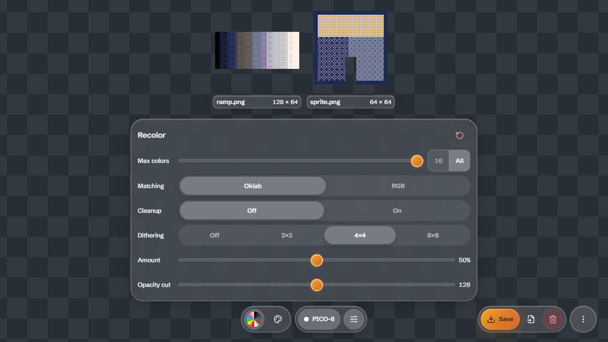
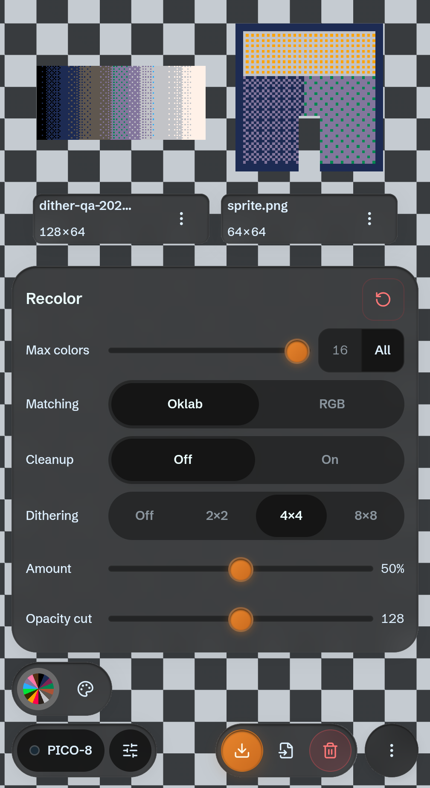

# Full palette dithering implementation and validation

Date: October 14, 2026 (runs continued into October 15 UTC). Research baseline: `061c880`. Production build: `index-BLKNhLPI.js`. Changes remain local until a separate push; pushing main deploys the app.

Optional ordered dithering is implemented for arbitrary full palettes, including two-color and eight-color targets. Off remains the default and preserves nearest output; the existing one-bit styles retain their separate controls. Recolor now offers Off, 2×2, 4×4 and 8×8, with Amount 0–100%, initially 50%. Zero preserves nearest conversion. Settings persist and reset correctly.

## Decisions and behavior

A source-anchored Bayer pattern avoids error propagation between pixels or frames. Exact active-palette RGB and the alpha threshold are preserved. The bounded kernel ranks four candidate colors with the selected Oklab/RGB matching metric and scores realizable linear-light pair mixtures perceptually. It is a heuristic, not exhaustive pair optimization or a claim to reproduce another service. Amount is not guaranteed to improve every image monotonically. Native-size sprite review remains useful before saving.

Auto and subset selection retain their existing source/frame weighting. Dither does not regenerate them. Cleanup operates on its frozen nearest-source decisions; approved source coordinates become solid replacements after dithering, while other pixels keep the pattern. Wall previews sample original source coordinates so pattern phase agrees with full-source exports. Dither and amount participate in retained-preview, animation-cache and immutable Save/Copy/ZIP/drag identity. Pending changes cannot publish obsolete pixels. Amount commits after a 200 ms pause or release/change and cancels when its gesture loses ownership.

Error diffusion is deferred: the independent research reproduced thousands of changes in unchanged image regions after changing one input pixel. Fixed ordered patterns avoid that propagation with a fixed palette/settings, but moving subjects can still move through the pattern. Existing one-bit diffusion styles remain available.

## Completed validation

| Check | Result and retained evidence |
| --- | --- |
| Complete Vitest suite and production build | 56 test files; 831 passed, two existing skips; build passed |
| Independent kernel adversarial checks | 54 seeded cases: target membership, binary alpha, exact entries, metadata, source immutability, sync/async, sampled phase and unchanged-coordinate animation stability; [results](../../bench/palette-dither-review/results.json) |
| Codex Browser built-app acceptance | 20 phases passed; [report](../../bench/palette-dither-review/desktop-acceptance.json) |
| Physical USB Pixel 8 Pro, Android 17, Brave | Same 20 phases passed at 448 CSS pixels; [report](../../bench/palette-dither-review/android-acceptance.json) |
| Native Android download | Visible touch image-actions → Save created a PNG in the phone Download folder. Pulled only the uniquely named owned fixture; independent PNG decoding matched full source conversion, visible RGB and alpha; [result](../../bench/palette-dither-review/android-native-download.json), [PNG](../../bench/palette-dither-review/android-native-download.png) |
| Existing production browser regression | Baseline `061c880`: 132 independently decoded legacy exports, nine full-palette, nine RGB, all additional integration checks and no JS exceptions; [report](../../bench/palette-dither-review/existing-palette-regression.json) |
| Boundary and stale-gesture review | Sandboxed Edge: 256 opaque colors plus empty uses correct RGBA PNG fallback; GIF and ZIP overflow reject atomically with zero downloads; stale Amount event regression passes; [report](../../bench/palette-dither-review/overflow-results.json) |
| Responsive inspection | 320 CSS pixel Codex Browser: no horizontal overflow and controls remain visible; 448 CSS pixel phone: no horizontal overflow, dither controls and range 44px high; [desktop dimensions](../../bench/palette-dither-review/desktop-320-layout.json), [phone dimensions](../../bench/palette-dither-review/android-layout.json) |
| Foreground kernel timing | Thirty cases per device with exact-color, alpha, membership, metadata and sampled-phase assertions; [desktop](../../bench/palette-dither-review/desktop-performance.json), [Android](../../bench/palette-dither-review/android-performance.json) |

Acceptance used original synthetic ramp, flat sprite and a three-frame GIF. Eleven configurations cover Off, every matrix at 0/50/100%, and RGB plus an eight-color cap plus Cleanup. It compares current wall/enlarged converted paint inputs with full-source reference conversion, independently decodes native PNG and GIF bytes inside ZIP, and checks GIF frame delays/loop. Additional phases cover rapid edits, export snapshots across later edits, Copy PNG payload, enlarged viewer Save/Original return, family return, persisted reload and Reset. Encoded PNG comparisons require exact alpha and visible RGB; RGB stored under alpha zero is immaterial and can differ between indexed PNG representations.

The acceptance harness intercepts clipboard writes and download anchors to inspect blobs, so that matrix does not prove OS clipboard permission/readback or physical filesystem saving. The separate Android native-download check above exercises real touch controls and filesystem output; desktop regression also exercises browser download events. Reference conversion in the acceptance server shares the production kernel, so integration agreement alone is not independent algorithm proof. The separate seeded property checks and independent encoded-image readers provide complementary evidence. Brave canvas privacy readback can perturb pixels; preview comparisons capture the app's putImageData input before browser readback noise.

## Performance and limits

Three warm async runs per case, including scheduler turns. For a 256×256 high-entropy image with 4×4 at 50%:

| Target colors | Codex Browser nearest / dither | Pixel 8 Pro nearest / dither |
| --- | --- | --- |
| 8 | 9.6 / 117.1 ms | 6.0 / 64.2 ms |
| 64 | 20.3 / 159.7 ms | 14.6 / 89.0 ms |
| 256 | 50.8 / 266.4 ms | 40.4 / 143.6 ms |

Repeated-color 128×128 sprite dither medians ranged 0.4–1.2 ms desktop and 0.4–2.0 ms phone. Across all thirty cases per device, no >50 ms task was observed; maximum rAF gaps were 16.9 ms and 25.1 ms. Highest progress intervals were 10.7 ms and 9.6 ms. These measurements do not establish clip FPS, whole-app memory bounds or universal responsiveness. Large/high-entropy inputs cost more; converted playback can slow while preserving source timing in exports. Whole-app stress and Safari remain separate work. Ordered texture can increase point error, grain, aliasing in reduced previews and file size.

The existing 8 MiB animation-index budget is unchanged. Dither scratch and memoization are bounded per job; the budget does not bound source images, export buffers or total heap. Off adds no dither scratch. Kernel modules are statically imported to preserve the existing synchronous API; enablement controls allocation and pixel work.

## Independent challenge and repairs

Three agents divided kernel implementation, integration and adversarial validation. The final reviewer traced preferences, local/global resets, family switching, wall/viewer/cache identity, immutable exports and native range ownership and found no unresolved actionable production issue in the reviewed scope. The [adversarial review](2026-10-14-dithering-adversarial-review.md) records limitations and the real stale-range bug found and fixed: a held old Amount control could otherwise commit into a newly selected matrix. Keyed ownership and detached listeners now reject it.

Two test issues were corrected without changing production behavior: invisible RGB in transparent PNG entries, and an older browser harness starting a second asynchronous import before the first appeared. The latter now waits for publication and checks ZIP order against the wall captured at the gesture; independent pixel, metadata and baseline byte checks remain. A family-switch harness wait was also added for the Svelte DOM update. Browser benchmark routing initially omitted a transitive import; that harness route was fixed before collecting the completed timing reports.

## Next useful work

1. Add actual used-color counts and quick 2/4/8/16 budgets with clear per-image versus collection wording. Avoid scans on hover.
2. Improve reuse: save the used palette, export palette strips/GPL, and compare one chromatic eight-color preset on real art before adding it. Keep the palette rail focused.
3. Evaluate target-color locks/source overrides and fitting Auto directly at the requested count. Require corpus comparisons, bounded work, shared-animation weighting and export snapshot tests.
4. Add an explicitly selected collection-wide subset budget only when scope and weighting are clear. Keep error diffusion deferred pending an animation-safe design.

The four independent spikes remain free of service source details and service reference files. Service-specific research is separate. REST/MCP output tests and website import controls are verified; website Generate/export output was unresolved at implementation time. A [later broader check](pixellab-review-2026-10-14/web-output-verification.md) has since verified four native website PNGs and an explicit incompatible-settings rejection; animation and partial-alpha website output remain untested. See [coverage closure](pixellab-review-2026-10-14/coverage-closure.md). This limitation does not block the locally specified and tested ordered-dither feature.

