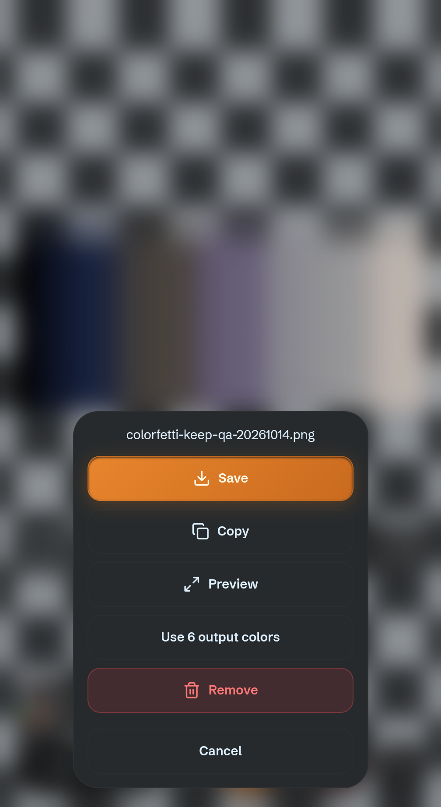

# Palette improvements: implementation and validation

Completed October 14–15, 2026. This batch improves palette choice, import, output
inspection and PNG opacity while retaining the existing matching algorithms and
fresh defaults. Separate implementation agents owned palette curation, import,
opacity and algorithm experiments; an independent reviewer challenged contracts,
code and lifecycle behavior. The [working checklist](2026-10-14-palette-improvements-todo.md)
records each decision and feature commit. Nothing was pushed or deployed.

## What users can now do

| Change | User workflow and deliberate limits |
|---|---|
| Two compact presets | Choose exact Black & white or ENDESGA 8 in Palette mode. Existing colors, selections and defaults remain. ENDESGA 8 is an authored look; its armor counterexample is retained in the [curation study](2026-10-14-curated-palette-selection.md). |
| Lospec links | Import palette → Paste colors → paste a full Lospec palette link → Import from Lospec → review → Save. Published credit/source stay local with the saved palette. Manual/file imports remain the fallback. |
| Actual used-color count | Preview, or Image actions on touch → Count output colors. The caption reports full converted output, including all GIF frames. Transparent pixels are excluded; counting is explicit to avoid expensive background work across the wall. |
| Output-palette reuse | After counting, Use N output colors opens a new named editor draft with those actual colors. Save locally or download HEX backup. It does not change artwork merely by opening the draft. |
| Original opacity | Recolor → Opacity Keep retains soft edges, shadows and effects exactly in PNGs. Cut retains the existing threshold behavior and remains the default. Keep hides the cutoff slider and remembers its previous value. |
| Faithful palette display | Full-palette thumbnails, swatches and native New/Edit color previews use paint-only canvases. This prevents the observed phone browser from silently turning pale swatches dark or treating dark colors as icons; browser preferences and palette values are unchanged. |

The new Palette dithering remains Off by default. Its strength and 2×2/4×4/8×8
source-pixel dimensions retain their explicit labels. Two-color Palette targets
support it; the separate 1-bit styles retain their own existing shading methods.

## Service comparison and research decisions

The [public-catalog study](2026-10-14-curated-palette-selection.md) covers all
seventeen observed PixelLab choices by role and overlap. The curated rail grows
from nine to eleven, with Lospec import providing specialized alternatives rather
than copying a long catalog. Sixty-four local conversions include real inventory
and armor sprites; both beneficial and adverse outcomes are shown.

Earlier direct service comparisons remain in the
[paired-output report](2026-10-14-palette-feature-review.md) and
[website verification](pixellab-review-2026-10-14/web-output-verification.md).
Four native website PNGs are verified; one count-two output is byte-identical to
the retained REST result for the same ramp. The website rejects the tested
combination of dithering and an additional color cap, which Colorfetti supports.
Fixed-palette membership was already working and is retained. Keep closes the
optional partial-alpha capability gap identified by the service comparison.
These bounded findings do not establish universal output superiority or all
website/MCP/API combinations. No new paid service reductions were needed here.

The [Auto-fitting and locks spike](2026-10-14-auto-fitting-and-color-locks.md)
contains 24 scope/count cases, three methods and 132 converted research PNGs.
Direct small-palette fitting lowers point Oklab error in 16/20 equal-scope cases,
but worsens four, including armor and a duration-weighted animation. A wall-wide
eight-color palette also differs from the current eight-color limit per image.
Retaining a red color can protect an exact red eye, but does not force a muted eye
to use it. Neither algorithm change nor color-lock controls ship in this batch.
Permanent 2/4/8/16 buttons are also deferred: the existing numeric field already
supports these values, and another mobile row has no demonstrated benefit.

The next algorithm experiment should refine from the existing selected subset,
retain it when a candidate worsens the same measured objective, and separately
check rare details and animation. A lower average error alone cannot establish
that eyes, outlines or material cues survive. Resolve per-image versus shared
palette-size semantics before adding a control.

## Verification

The production build used for retained browser/device results has index SHA-256
`0b61657e4bf8e35317a45bd2973d02cc94282855b1f9d14b5b8435eb94822d20`.
The native phone download was captured before the caption and color-preview UI
fixes, on index `261b51520cba30c9df23a9dce313f4767d9943269a3b32980268b051c484645a`.
Conversion/encoding code is unchanged between those builds. The final build
repeats both 15-phase device suites and nine responsive/lifecycle/forced-dark phases.

| Layer | Result and evidence |
|---|---|
| Unit suite | 59 files; 910 passed, 2 existing skips. Includes alpha 0/1/127/128/254/255, every ordered pattern, source-coordinate sampling, Cleanup, Auto visibility, snapshots/cache accounting, partial-alpha PNG decoding, binary byte compatibility, GIF replay rejection, atomic ZIP failure and validated color-preview painting. |
| Build | `npm run build` passed; no new dependency. Lospec fetching and full-output inspection remain lazy modules. |
| Pre-feature regression | [Baseline results](../../bench/palette-improvements-review/baseline-results.json): 132 legacy one-bit exports, eleven Palette and eleven RGB cases, plus thirteen integration groups. Independent PNG/GIF readers and old encoders verify pixels/bytes; no runtime errors. Baseline `5aa6418`. |
| Adversarial lifecycle | [Sandboxed Edge results](../../bench/palette-improvements-review/edge-results.json): held optional modules/responses, cancel/replacement, stale input, close/reopen, Count→Reset/family/removal, held Auto refresh and detached opacity slider. [Independent review](2026-10-14-palette-improvements-adversarial-review.md). |
| Responsive usability | The same nine-phase Edge run verifies 320×568 and 568×320 touch layouts: 44-pixel controls, reachable settings/editor actions, Preview Count/Use and nine counted tiles. Numeric text ranges remain fully visible before dimensions; captions truncate without overlapping Image actions. Scoped screenshots accompany the JSON. |
| Forced-dark color fidelity | Independent Edge screenshot decoding verifies sixteen swatches, thirty-two pie probes and native New/Edit value/hit-target updates while a CSS control demonstrably darkens. [Phone screenshot checks](../../bench/palette-improvements-review/android-color-fidelity.json) verify twelve solids and sixteen inner pie probes exactly under unchanged native Brave darkening. Outer probes can differ by one channel byte from rasterization/compositing; those [measurements](../../bench/palette-improvements-review/android-pie-raster-diagnostic.json) are retained. |
| Codex Browser | [15 phases passed](../../bench/palette-improvements-review/codex-results.json), including live SLSO8 import, exact alpha/payloads, whole-GIF count, reused swatches/HEX/library restoration and captured settings across later edits. |
| Physical USB Android | [Same 15 phases passed](../../bench/palette-improvements-review/android-results.json) on the authorized Pixel 8 Pro, Brave Chromium 155, 448 CSS-pixel viewport. Live Lospec import succeeds. Actual OS is Android 17; the browser's reduced user-agent reports Android 10. |
| Actual phone download | [Native Save record](../../bench/palette-improvements-review/android-native-save.json): the image-actions Save flow wrote a 1,912-byte PNG to Downloads. Pulled only that uniquely named test file; independent decoding confirms six target RGB colors and source alpha 0/127/128/255, matching the captured conversion. |

Five material issues were found and fixed during work: legitimate Lospec
octet-stream responses were initially rejected; Auto's newly published swatches
invalidated a pending count despite an unchanged captured wall; and a detached
cutoff slider could update remembered settings after switching to Keep. The final
responsive pass also found dimensions hiding the count on dense phone tiles;
count-first captions now keep the useful number visible. Finally, native Brave
forced darkening visibly changed CSS swatch colors despite author color-scheme
opt-outs. A pale-only SVG experiment looked correct but failed the broader dark/
bright-color challenge; it was rejected before commit. Paint-only canvas preserves
the tested colors without changing browser preferences or file conversion. Retained
regressions cover these paths. No outstanding actionable production finding was
identified in this reviewed scope; this is not a guarantee of no possible bugs.

## Performance, memory and test boundaries

Keep adds exactly one alpha byte per converted sample. The shared animation cache
still has an 8 MiB reservation limit and charges the extra byte. Partial-alpha PNGs
use RGBA8 rows, which can cost more memory/bytes than indexed PNG. Cut does not
allocate the alpha buffer. Counts retain tiny RGB metadata, not converted frames;
Count followed by Save can repeat conversion by design.

The retained four-case source-kernel timing phase uses 256×128 images, 4×4 at 50%,
one warmup and three measured runs. On the phone, binary Cut/Keep medians were
32.9/32.6 ms for the same 28,672 visible pixels. Partial Cut/Keep were 18.7/32.4 ms,
but Keep processes 28,672 visible pixels versus Cut's 16,384. Those totals measure
different work. The final Codex binary medians varied markedly (78.4/118.3 ms);
run order, compilation and machine load prevent a causal overhead or speedup claim.
No task above 50 ms was observed in the supported app/kernel observation windows;
kernel maximum rAF gaps were 16.9 ms Codex and 16.8 ms phone. These are bounded checks,
not FPS, whole-app memory, universal responsiveness or controlled speed benchmarks.

The common acceptance HTML captures actual encoded Blob/clipboard payloads before
download/clipboard dispatch. PNG/GIF decoding is independent of the encoders;
expected recoloring uses the production conversion pipeline, supplemented by
explicit source-alpha/membership tests. This is not an independent mathematical
oracle for artistic quality. OS clipboard readback remains untested. The separate
native phone download verifies a real filesystem result. The independent reviewer
also decoded both that PNG and the original ramp with Sharp and compared all
8,192 source alpha bytes exactly, separately from the server's recoloring oracle.
New/Edit input values, hit targets and display updates were exercised; the native
OS color-picker interaction itself was not opened by these checks. Safari/iOS remains
untested; existing Google sign-in/browser limitations are unrelated to these local
features. Vendor source code or extension files are not referenced in the research spikes.

## Reproduction

- Unit/build: `npm test`, `npm run build`.
- Frozen-build regression: `BASE_REF=5aa6418 node bench/palette-qa.mjs dist` (set
  the environment variable using the current shell). Do not rebuild `dist` while
  the static harness is serving it.
- Lifecycle: `node bench/palette-improvements-qa.mjs dist`, installed Edge with
  Chromium sandbox enabled. Palette-service responses are synthetic/intercepted.
- Cross-device: `node bench/palette-dither-qa-server.mjs`, open `/improvements`,
  optionally enable the real public Lospec test and choose Run palette improvement
  checks. Test-only hooks leave the production build untouched. Phone access uses
  temporary USB loopback forwarding; it does not expose the server publicly.
- Research: `node bench/palette-curation-spike/run.mjs` and
  `node bench/palette-fitting-spike/run.mjs`.
- Phone color fidelity: `node bench/palette-improvements-phone-color-qa.mjs` after
  serving the frozen build above, creating the owned `/app/?keep=1` demonstration
  tab in the authorized phone browser and forwarding its debug socket to local
  port 9333. The harness uses the generated `.tmp/dither-qa/ramp.png` fixture and
  dismisses its own text keyboard before screenshot coordinates are sampled.
  It leaves browser preferences unchanged; remove the temporary debug forward
  afterward. [Build record](../../bench/palette-improvements-review/build-record.json)
  identifies the tested source and the older native-download build.
