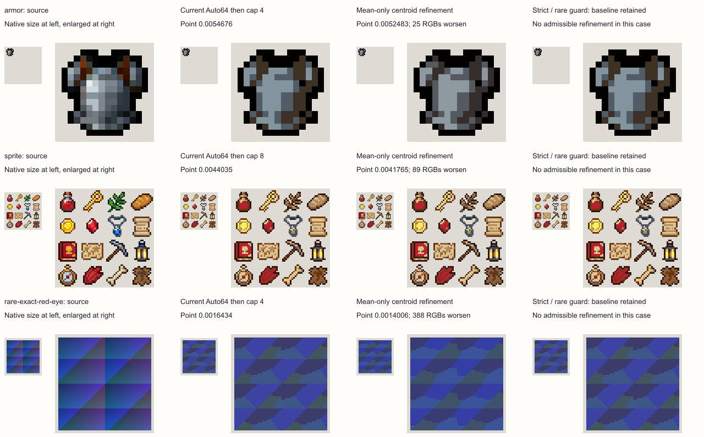

# Guarded Auto refinement

Keep the current Auto palette and Max colors pipeline. This experiment does not
justify a production refinement step. Mean-only refinement usually lowers its
chosen average error while worsening some source colors. The strict and rare-color
guards accepted no changes in the tested corpus. Refinement that invents RGBs also
breaks the existing shared Auto target, independently of its error score.

This is an offline research spike. It changes no production conversion or UI code.
The implementation, fixtures, measurements and visual counterexamples remain
under [bench/auto-refinement-spike](../../bench/auto-refinement-spike/index.html).

## What was tested

Run `node bench/auto-refinement-spike/run.mjs`, then
`node bench/auto-refinement-spike/figures.mjs`. The
[results](../../bench/auto-refinement-spike/results.json) contain every palette,
guard outcome, source/dependency hash, metric, timing sample and retained image.
The candidate is a self-contained research module, separate from shipping code.

The baseline calls the unchanged generator with a captured source wall, obtaining
up to 64 shared Auto colors. It then calls the current limiter independently for
each asset, including all duration-weighted frames of a GIF. An independent call
through `fullPaletteImage` verifies the resulting subset. This retains the existing
per-asset cap; it never substitutes one K-color budget for an entire wall.

There are 13 source items: the original 64×64 inventory sheet and 16×16 breastplate;
gray ramp; RGB cube; exact and muted one-pixel eyes against thousands of shaded
pixels; a rare outline and material stripe; saturated colors; nearby warm/cool
details; partial-alpha boundary values; a deterministic 6,144-color image; the
independently decoded three-frame armor GIF with delays 40/160/80 ms; and a
synthetic short-held-highlight animation. All use owned or previously retained
project fixtures. Only the inventory sheet and breastplate are distinct real-art
sources; generated adversaries do not substitute for a broad artist corpus.

The **176 asset/settings observations** are 112 single-asset observations plus
64 per-asset observations within a four-asset wall. They are not 176 independent
images. Counts 2/4/8/16 and Oklab/RGB Matching are covered. Cut128 applies throughout;
the partial-alpha source and four-asset wall additionally use Keep, with eligibility
cut1 and unchanged original alpha. Generation retains equal nonempty asset mass.
Refinement retains frame-duration weighting within each asset without alpha
weighting, compositing or frame-by-frame palette fitting.

## Candidate and acceptance rules

Both methods initialize from the actual current selected subset:

| Method | Search | Shared target identity |
| --- | --- | --- |
| Centroid refinement | Up to six alternating nearest assignments and weighted centroid updates; integer RGB rounding and explicit gamut clipping | Can invent new RGBs per asset; therefore changes the current contract |
| Exact subset swaps | Up to six additional improving swaps, evaluated on original source RGBs rather than reduced bins | Every selected RGB remains in the original shared Auto palette |

Centroid colors retain their slot order. Empty clusters retain their prior RGB;
integer collisions stop the trajectory before reducing cardinality. Subset swaps
retain shared-target order. Each method considers these three guards against the
**original baseline**, never a gradually weakened reference:

| Guard | What it protects | What it cannot promise |
| --- | --- | --- |
| Mean only | Lower duration-weighted mean nearest error | Individual source colors, highlights, material cues or local tone |
| Strict | No positive nearest-error increase for any visible original source RGB; no epsilon; exact baseline/source RGBs remain literal palette members | Shared-target membership for invented centroids, artistic preference, or downstream dither/Cleanup quality |
| Rare color | No nearest-error increase for source RGB groups contributing at most 1% of visible duration mass; exact baseline/source RGBs retained | Semantic rarity, spatial features, or larger color groups |

All require mean improvement exceeding `1e-12 * max(1, baselineMean)`. That aggregate
noise floor never relaxes the strict per-RGB veto. The research histogram is bounded
to 16,384 unique source RGBs. Exceeding it conservatively retains the baseline and
reports an incomplete/null objective; it does not certify a binned guard.
In high-color images where every RGB group is below 1% mass, the rare policy becomes
as restrictive as the strict policy. These outcomes do not prove that every possible
semantic constraint or refinement strategy must fail.

The centroid pattern follows the familiar nearest-assignment/centroid approach in
[Lloyd's quantization paper](https://web.stanford.edu/class/ee398a/handouts/papers/Lloyd%20-%20Least%20Squares%20Q%20in%20PCM.pdf).
Its constrained integer/gamut version is measured here rather than assumed to
inherit an unconstrained optimum guarantee. The Oklab transform follows
[Ottosson's primary description](https://bottosson.github.io/posts/oklab/).
Neither reference establishes semantic preservation for pixel art.

## Results reject silent adoption

| Method / guard | Changed observations | Outside shared Auto target | Other findings |
| --- | ---: | ---: | --- |
| Centroid / mean | 175 / 176 | All 175 changed observations | Up to 2,834 source RGB groups worsen; exact source matches change in 65 observations |
| Centroid / strict | 0 / 176 | 0 | Baseline retained |
| Centroid / rare | 0 / 176 | 0 | Baseline retained |
| Subset swaps / mean | 6 / 176 | 0 | Each improvement worsens 10–246 source RGB groups; exact matches change in two observations |
| Subset swaps / strict | 0 / 176 | 0 | Baseline retained |
| Subset swaps / rare | 0 / 176 | 0 | Baseline retained |

The six permissive subset improvements are small and remain unsuitable for a
no-regression claim:

| Observation | Mean error reduction | Source RGB groups made worse |
| --- | ---: | ---: |
| Gray ramp, Oklab, K16 | 1.599% | 12 |
| Gray ramp, RGB, K4 | 1.447% | 23 |
| Outline/material, Oklab, K16 | 0.595% | 10 |
| Outline/material, RGB, K16 | 0.048% | 14 |
| Partial alpha, Keep, Oklab, K8 | 1.176% | 32 |
| 6,144 colors, Oklab, K16 | 0.084% | 246 |

Shared-target identity is a separate hard gate. In the Cut/Oklab four-asset wall,
current per-asset caps use 8/16/27/46 RGBs in total at K2/4/8/16. Mean centroid fits
use 8/16/31/55, including new colors outside the shared Auto palette. Matching the
per-asset count does not preserve a common target or cross-image color reuse.
Strict and rare outputs retain the original union because they accept no changes.

The K4 breastplate illustrates the limitation: mean centroid error falls 4.01%,
but 25 source RGB groups worsen, 13 exact-match source pixels change, and its
remaining warm material tones shift toward gray/purple. Its local block-tone
error rises from 0.0021548 to 0.0025386, about 17.8%, on only **4 eligible blocks
out of 16**. This is not a whole-sprite tone score. The inventory K8 mean improves
5.15% while 89 source RGB groups worsen and 26 exact-match pixels change.

The eye fixture is also deliberately adverse: at K4 both baseline and candidate
already fail to preserve the source's exact red eye. Refinement's lower overall
error does not repair it. It would be incorrect to describe the baseline as having
preserved that eye or to attribute its original loss solely to refinement.

## Dithering, Cleanup, alpha and animation

Seven focal asset/settings observations run through actual production conversion
with Cleanup Off/On and ten dither configurations: Off, plus 2×2/4×4/8×8 at strengths
0/50/100. These are **140 settings comparisons**, with repeated zero-strength
nearest controls; they are not 140 independent quality examples. Unchanged guard
outputs are deduplicated, leaving mean-centroid output as the changed candidate.

All 140 candidate mean point scores are lower in this cohort, but **26 local
block-tone scores worsen**. This observation does not prove a nearest-point guard
protects either downstream algorithm; strict candidates never changed here.
Cleanup's frozen replacement-site **membership masks** differ at 11 inventory
coordinates and two breastplate coordinates. That measurement compares whether a
site is marked; it does not establish replacement-RGB equality at still-marked
sites. A future accepted candidate would require that additional comparison.

All measured outputs preserve expected alpha, color budgets and their own target
membership. GIF outputs use one palette across every frame and retain source
durations; unchanged source coordinates exhibit zero output churn. Seven focal
strict results also pass production PNG encoding and independent Sharp decoding,
comparing every alpha byte and visible RGB. Because strict changes none of those
palettes, those roundtrips validate the retained baseline, not a newly accepted
fitted palette. Hidden RGB under alpha zero is intentionally not compared.

## Costs and cross-device checks

The Node measurements time the research function computing **all three guard
choices together**, not an optimized production path for one guard. Three samples
give these medians:

| Source/settings | Centroid + three guards | Exact swaps + three guards |
| --- | ---: | ---: |
| Inventory, Oklab K8 | 0.51 ms | 8.81 ms |
| 6,144 colors, Oklab K16 | 16.31 ms | 451.49 ms |
| Partial alpha, Keep, RGB K8 | 0.49 ms | 3.17 ms |

Samples vary substantially; the 6,144-color swap runs span about 123–459 ms.
There is no standalone timing for each guard. The optional exact distance matrix
alone reaches 8 MiB at the research bound, excluding Maps, vectors, source data,
browser/GPU storage and production caches. This is not a suitable unmeasured
addition to the phone pipeline.

Root's foreground [Codex Browser](../../bench/auto-refinement-device-review/codex-results.json)
and [USB Android](../../bench/auto-refinement-device-review/android-results.json)
runs independently check 12 representative cases × two methods, including Keep,
the GIF and more than 4,096 unique RGBs. All **24 checks per device** complete with
strict output unchanged, exact source matches retained, valid alpha/membership,
determinism and stable frame metadata. Frozen candidate and fixture hashes match
the main run. Pre-cancel and in-flight cancel checks pass.

A separate 256×128 source-kernel test compares current subset selection with the
same selection plus this research swap refinement. Median times are 24.9 → 91.0 ms
in Codex Browser and 26.8 → 65.1 ms on Android. This includes all three policy paths;
it excludes decoding, workers, caches, UI and downloads. In-flight cancellation
takes about 9.1/8.3 ms respectively. The supported long-task observers record tasks
up to 69/68 ms across the broader research harness, which also contains synchronous
oracles and production conversions. These tasks cannot all be attributed to the
candidate, and the run does not establish jank-free application behavior.

## Decision

Do not ship either method as an automatic improvement. The preserving alternative
offers no admissible gains under the tested guards; permissive centroid gains
change target identity and individual colors. Extra source passes, allocations,
worker/cancellation/cache integration and new failure modes have no demonstrated
benefit under the current contract.

Keep the adverse examples. If future evidence motivates another study, define a
separate opt-in adaptive-palette contract before inventing per-asset RGBs, and use
broader real-art review with explicit material/detail checks. Do not weaken the
guards until something ships, and do not describe lower average error as proof of
no visual regressions. The older direct-K study remains historical evidence; this
run records its own current dependency hashes instead of retroactively assigning
new hashes to the older measurements.
