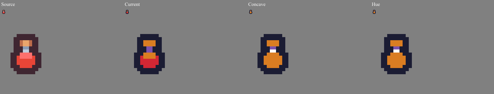
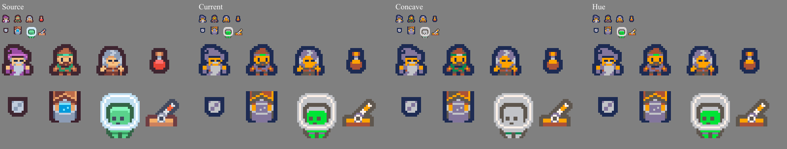

# Small important colors: independent acceptance and challenge

Frozen cohort and acceptance, October 15, 2026, before viewing candidate results.
Baseline `4566494`. Research only; no production source edits authorized.

## Question and predeclared gates

Can a bounded automatic subset choice retain useful tiny details at 2/4/8/16 colors
without sacrificing important existing features or neutral material ramps? A color
being available in a palette is not evidence that the eye, liquid or headband uses
it. The test evaluates mapped source coordinates.

**Hard invariants:** unchanged source dimensions and eligible alpha mask; every
output RGB belongs to the selected target subset; output color count does not
exceed the requested budget; cap at/above palette length and All remain identical;
animation shares one duration-weighted subset and unchanged coordinates do not
flicker; source order/chunking must not create a different result. Original source
arrays remain immutable. No semantic claim may be inferred from a histogram alone.

**Detail evidence:** at predeclared regions, measure source-to-output Oklab error,
chroma and hue when chroma is sufficient, and contrast against adjacent pixels
outside the region. Hue retention must not count neutral or invisible replacements
as preserved. Record exact matching source colors separately; no blanket preference
for exactness over coherent shading. Whole-image RGB channel RMSE and independent
Oklab error, skin/neutral region errors, and actual rendered contact sheets expose
the cost paid elsewhere. A distinct-color count alone is not a quality score.

**Meaningful-regression decision:** any new obvious material/skin hue error,
destroyed intended feature, visibly stepped/flattened important ramp, or animation
instability blocks automatic shipping. Numerical flags for inspection are an
increase of more than 2 RGB channel RMSE values (0–255 scale), more than 10% Oklab
mean squared error, region Oklab RMSE increase greater than 0.02, or region contrast
falling from at least 0.04 to below 0.02. These flags are review prompts, not a way
to excuse a visible regression below a threshold. A good average does not erase a
negative example. Constants and acceptance do not change after candidate results.

Use no more than two review rounds. First evaluate frozen candidates and all
negative cases; second independently challenge only a concrete acceptance/fix
proposal, or confirm a no-ship decision. No endless coefficient tuning.

## Frozen cohort

[Manifest](../../bench/important-colors-review/manifest.json) freezes paths,
hashes, source licensing, settings, semantic regions and animation delays before
candidate output. Twelve real opaque/binary sprites are unmodified PNGs from
Kenney Tiny Dungeon, Tiny Town and Pixel Platformer. The real inventory montage
places eight of them at integer positions without resampling/recoloring, to make
water/headband/potion/skin/neutral materials compete in one budget. The supplied
alternate pilot poses form a two-frame real-art sequence (60/140 ms); they are not
claimed to be a complete authored animation.

The retained owned two-frame knight reproduces the existing cloth/eyes/gem
counterexample. New owned neutral-ramp controls include **identical pixel arrays**
whose lone red pixel is described once as an intentional eye and once as accidental
noise. A purely pixel-statistical method must produce the same result for both;
this is a deliberately unresolvable intent ambiguity, not two independent assets.
Preserving an eye does not prove that rare corruption should also be amplified.

License evidence and archive hashes are recorded in the manifest; author licenses
are retained under `licenses/`. Fetch scripts treat archives as data and ignore
unselected downloaded contents. Official sources: [Tiny Dungeon](https://kenney.nl/assets/tiny-dungeon),
[Tiny Town](https://kenney.nl/assets/tiny-town), [Pixel Platformer](https://kenney.nl/assets/pixel-platformer),
all [CC0 1.0](https://creativecommons.org/publicdomain/zero/1.0/).

## Results

**Reject both automatic replacements.** The useful improvements are real, but the
bounded challenge finds material and identity losses in existing good outputs.
No candidate receives region labels or artist intent. No candidate coefficient,
setting exception or source subset was tuned after results to hide those losses.

The candidate run contains 640 item/settings rows. The independent reviewer
decoded the saved native PNGs with Sharp for all 101 rows whose outputs change
under at least one rule, then computed separate RGB/Oklab/region statistics in
`bench/important-colors-review/independent-results.json`. The measurement module
imports neither application nor candidate modules. The candidate harness's
unweighted-copy equality, membership/alpha/cap assertions and separate technical
checks remain distinct evidence; this reviewer does not relabel those as an
independent implementation oracle.

### Six concrete second-round confirmations

[Focused results](../../bench/important-colors-review/confirmed/results.json)
retain source/output PNG and raw RGBA hashes, every regional output RGB/count,
source-to-output region errors and context. The six figures have a uniform gray
background, explicit Source/Current/Concave/Hue labels, original-size views and
nearest-neighbor enlargements. The reviewer inspected all six current figures.

| Source / target / Matching / limit | Confirmed regression |
| --- | --- |
| Real water bucket / Auto / Oklab / 4 | Concave replaces 47 warm bucket pixels with 19 gray and 28 pale gray pixels. It still fails to restore blue water. Bucket-region chroma falls .09475 → .02863; regional Oklab RMSE rises .07913 → .11885. |
| Real inventory / Auto / Oklab / 8 | Hue restores the purple wizard hood, but 19 green headband pixels become `#8b9bb4` gray. Headband mean hue error rises 8.22° → 63.16°; chroma falls .08320 → .03637. |
| Real red potion / ENDESGA 8 / RGB / 4 | Both rules replace the 18 red liquid pixels (`#d32734`) with orange (`#da7d22`), making all 26 liquid pixels orange. Region Oklab RMSE rises .08056 → .11372. |
| Owned knight / PICO-8 / Oklab / 4 | Both rules replace 15 peach face pixels (`#ffccaa`) with gray (`#c2c3c7`). Mean face chroma falls .08868 → .03755. This skin ROI is an explicitly observational check of the existing fixture's known skin RGBs, not a newly frozen test fixture. |
| Real inventory / PICO-8 / Oklab / 8 | Concave replaces the 76 currently bright-green visor pixels with gray. Of the 102 source visor pixels, 96 become gray; mean visor chroma falls .18730 → .00701. |
| Real axe / PICO-8 / RGB / 2 | Hue replaces all 24 neutral blade pixels with vivid pink `#ff77a8`, to preserve a tiny warm fastening. Blade Oklab RMSE rises .10553 → .22240 even though whole-image Oklab error improves slightly. |

The inventory regions are exact translations of the frozen component regions at
their frozen assembly positions, restricted to those component coordinates. They
do not accidentally count the same RGB in another sprite. All cases use Cut128,
Dithering Off and Cleanup Off. These are observed material/identity losses under
the predeclared gate, not a rejection merely because an objective function changes.

Useful gains coexist with those losses: concave can keep blue/cyan water under
some fixed-palette caps, and hue can recover tiny blue eyes or a purple hood. The
exact paired service comparison independently confirms that the service keeps
both the inventory's hood and headband in one eight-color result where the hue
rule trades one for the other. The service is still not a semantic oracle: it
loses blue water elsewhere and rewrites colors that current higher-cap output
retains exactly. No across-the-board superiority is supported.

### Invalidated random-label review

An attempted random-label sheet review was discarded. The reviewer misread an
identical pair of visible outputs as different; an initial raw-crop comparison
then falsely suggested output drift. The crop difference was the phase of the
checker background across 300-pixel columns. Comparing only alpha-visible pixels
proved **zero RGB differences**; five independent candidate-author repetitions
also matched exactly. The output-drift/race explanation is retracted, not an app
bug. All provisional judgments and preference tallies are invalidated and ignored.
See `bench/important-colors-review/blind/STATUS.md`.

The six explicit-label confirmations above use current PNG hashes and mapped
region RGBs on a uniform background. They are an unblinded confirmation, **not**
a blind preference study. Neither this report nor the final decision may count
the discarded ratings as additional evidence.

### Bounded decision and limitations

Round one froze data/criteria, ran the candidates and flagged losses. Round two
confirmed actual region RGBs and native images with the candidate and service
reviewers, while the orchestrator checked the same decisive examples independently.
All agree that both candidates fail the meaningful-regression gate. No third
coefficient search or automatic implementation is justified by these findings.

This reviewer does not claim browser/phone or full-app import/export/performance
coverage. Those receipts belong to the orchestrator's validation report. The real
cohort is twelve source views from one author/style family plus a montage, and its
two-pose pilot sequence is a limited animation test. A source image whose red pixel
is intentional is identical to the accidental-noise control; no automatic
histogram/hue method can know which interpretation the artist intended.

A separately designed manual protection workflow could express that intent, but
it must distinguish target availability from actual mapped use, resolve a protected
color count exceeding the requested budget, and work clearly on mobile. This study
does not authorize adding that UI or an automatic setting. Existing behavior,
specification and defaults should remain unchanged.
