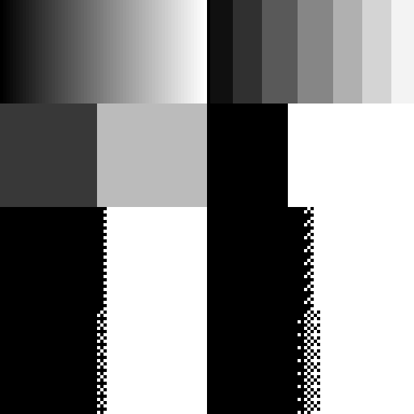

# API and MCP palette evidence

Research date: October 14, 2026. This is competitor evidence, not a product implementation spike. All tested images are synthetic fixtures created for this review. No user artwork was uploaded. No application source was changed.

## Sources and method

- [REST entry point and endpoint index](https://api.pixellab.ai/v2/llms.txt).
- [Live REST schema](https://api.pixellab.ai/v2/openapi.json) and [interactive reference](https://api.pixellab.ai/v2/docs).
- [MCP user guide](https://api.pixellab.ai/mcp/docs) and authenticated `initialize`, `tools/list`, `tools/call` over the documented HTTPS MCP URL.
- [Published API price estimates](https://www.pixellab.ai/pixellab-api).

The environment credential authenticated successfully on both interfaces. Scripts read it from `PIXELLAB_SECRET`; it is never written into artifacts or printed. The supplied MCP configuration example was consulted only to identify transport and environment-backed authentication. Both interfaces were used live; this review is not solely a documentation survey.

Evidence lives in `bench/palette-service-research/api-*`. `api-schema.json`, `api-palette-controls.json`, `api-smart-schema.json`, and `api-mcp-tool-schemas.json` preserve relevant public interface contracts. `api-results.json`, `api-extra-results.json`, `api-matching-results.json`, and `api-analysis.json` contain request parameters, fixture hashes, response status, latency, reported usage and decoded output measurements. Output PNGs and returned palette strips are retained. Validation-error echoes of fixture base64 are replaced with hashes.

## Supported controls and interface differences

| Capability | REST | MCP | Observation |
|---|---|---|---|
| Automatic palette size | `/reduce-colors`, omit both selectors | `reduce_colors`, omit both selectors | Live tested, deterministic on repeated gradient |
| Explicit count | `num_colors`, integer 2–256 | Same bounds | Actual output can use fewer colors |
| Existing target palette | `palette_image` PNG object | `palette_image_base64` or `palette_image_url` | Strict visible RGB membership in tested images |
| Count and target together | Rejected | Advertised as mutually exclusive | REST 422 verified |
| Ordered dithering | `none`, `2x2`, `4x4`, `8x8` | Same | All sizes live tested |
| Dither strength | 0–10, default 5 | Same | Zero equals none in tested fixture |
| Multiple frames | `images` list, same dimensions | Base64 list or URL list | Shared palette verified |
| Returned palette | Synchronous palette PNG strip and `n_colors` | Asynchronous job, inline image and download URL | REST strip can be reused as a target |
| Smart palette mapping | `target_palette.smart` on Pro image generation | Not exposed by `create_image_pro` tool schema | Separate from deterministic reducer |
| Target plus maximum | Pro `target_palette.colors` plus `max_colors` 2–64 | Pro `palette` plus `max_colors` 2–64 | Reducer lacks this combination |

REST `/reduce-colors` accepts PNG base64 objects, returns synchronously, and documents a total limit of 262,144 pixels across equal-size frames. MCP accepts HTTPS/data/upload references or base64, returns a job immediately, and requires `get_image`. MCP says to prefer URL transport because clients may truncate large base64 arguments. A completed MCP test also saved the synthetic output to the account's Creator gallery; this is a real side effect of using that interface.

No public named-palette catalog endpoint was found in the fetched REST paths or 117 live MCP tool definitions. PICO-8, Game Boy, NES and Lospec are examples of names/hex inputs, not evidence that a name alone resolves to an exact built-in palette. Website presets are covered by the separate website review.

### Broader palette-conditioning inventory (schema evidence only)

`api-surface-inventory.json` records matching top-level REST request fields, and `api-mcp-palette-surface.json` records live MCP input schemas including nested style options. The following routes were **not generated through simply to exercise these options**; their support and limits here are documented contracts, not output-quality findings.

| Surface | Palette-related contract | Product interpretation |
|---|---|---|
| Pro freeform creation | `target_palette.colors`, optional `name`, `max_colors`, `smart`; separate style-reference color-copy flag | Exact target, cap, semantic mapping and style conditioning are distinct choices |
| Pro text animation | Same target/cap object, smart explicitly disallowed; reference mapped before animation | Animation consistency is an explicit API concern |
| Pixflux, Pixflux-background, Bitforge creation | `color_image` palette image | Earlier image-conditioning contract; do not assume current reducer behavior |
| Character animations, four/eight directions | `color_image` reference; several request routes are aliases | Character sets can carry a palette reference |
| Character state editing | `use_color_palette_from_reference`, default false | Preserve an existing character's colors when editing other aspects |
| Legacy text/skeleton animation, rotate, inpaint | `color_image` described as forced palette | Documented conditioning, not independently verified strict output membership |
| Legacy edit | `color_image` described as color reference/style guidance | A hint/reference is weaker than a measured hard target |
| Top-down/sidescroller tilesets, isometric tile, map object | `color_image` reference/forced palette | Game-wide palette consistency across asset classes |
| UI generation | `color_palette` text (up to 200 characters), style image where supported | Named/color-language hints are not literal palette enforcement |
| Resize | `color_image` forced palette | Resampling and snapping can be coupled |
| Unzoom | `quantize: 0` auto, `-1` preserve downsample colors, 2–256 count | Pixel-grid recovery and palette reduction are separate controls |
| Pro Flash edit | `use_color_palette_correction`, default false | Optional correction flag, output guarantees untested |
| Style-image models | Nested style flags include `color_palette`; several also expose outline/detail/shading | Style-reference colors can be disabled while other aspects stay active |

MCP exposes some of these through different tool contracts: `create_image_pixflux` takes a palette image URL/base64; `create_image_pro` takes a hex array, name and cap; `create_character_state` exposes reference-palette preservation; `create_ui_asset` takes palette text; Pro Flash tools and `create_tiles_pro` include nested palette-copy style settings. Absence of a field from a particular MCP tool should not be worked around by assuming its REST counterpart accepts identical arguments.

## Live reduction results

| Test | Measured result |
|---|---|
| Auto, 64-level neutral ramp | 34 RGB colors; repeated output decoded pixel hash identical |
| Explicit 8 on ramp | 8 visible RGB colors, 8-entry returned strip |
| Explicit 2 on ramp | 2 generated colors; generated endpoints need not be black and white |
| Explicit 8 on two-color source | 2 colors, not 8; no artificial colors introduced to satisfy the count |
| Explicit 256 on 64-color source | 64 colors |
| Four-color target on ramp | All visible RGB values in target; 4 used colors |
| Same target on two shifted frames | Both outputs restricted to same four target colors |
| Explicit 8 on two shifted frames | Both outputs share exactly the same eight generated RGB colors |
| `num_colors` plus palette | 422 with actionable mutually-exclusive-selection message |
| Explicit count 1 | 422, lower bound 2 |
| Mismatched frame dimensions | 422, message identifies both sizes |
| Unknown `smart` reducer field | 422, additional fields forbidden |
| Single-color target | Accepted; output uses its one color, although explicit count cannot be 1 |
| 257-color target | 422, max 256 message |
| Completely transparent source | Remains fully transparent; `n_colors: 0`; returned strip is transparent 1×1 |

Successful REST reduction latency in this sample ranged from 260 ms to 1,647 ms, including network transport, after initial setup. These are tiny fixtures, not throughput or large-animation claims.

### Size boundary and fixed-coordinate temporal follow-up

Four additional bounded requests tested the advertised area limit and unchanged-coordinate stability. All larger images contained only two opaque RGB colors and compressed to small PNG payloads; these are boundary checks, not representative performance benchmarks.

| Input | Status / result | Request latency |
|---|---|---:|
| One 512×512 frame, 262,144 pixels | 200, dimensions retained, two colors | 4,157 ms |
| One 513×513 frame, 263,169 pixels | 422; message gives 262,144 total-pixel maximum | 223 ms |
| One 1024×256 frame, 262,144 pixels | 200, dimensions retained, two colors | 3,427 ms |
| Two 64×32 frames differing at one pixel, fixed four-color target, 4×4 dither at strength 5 | 200; exactly one output pixel differs | 1,531 ms |

The equal-area non-square case establishes that 512 is not a per-axis dimension cap for this reducer. With the fixed target and ordered dither, **none of the 2,047 unchanged source coordinates changed output color** when a different source coordinate changed. This verifies zero fixed-coordinate churn for that pair. It does not measure object-relative dither phase during motion, inferred palettes changing between calls, or duration weighting. Requests and measurements are in `api-limits-temporal-results.json` and its dedicated reproduction script.

### Alpha and color-count traps

The reducer preserves source partial alpha values exactly. The alpha fixture had eight alpha levels: 0, 1, 64, 127, 128, 192, 254 and 255, each appearing 32 times, before and after quantization. It did not apply a transparency threshold.

However, reported `n_colors` counts distinct nonzero-alpha RGBA tuples in these tests, rather than unique visible RGB palette entries. With two RGB values and seven nonzero alpha levels, it reported **14**, even with a requested limit of 2 or 8. The returned strip had just **two opaque RGB entries**. Fully transparent pixels were excluded. This behavior is verified for the fixtures; it is not a guarantee for every representation.

Alpha in the **palette image** has a different contract: it was ignored. A four-color target with alpha 0, 1, 128 and 255 produced exactly the same opaque-source output as an all-opaque target. Even the fully transparent target pixel's hidden RGB became an available opaque candidate. Importing a palette image with transparent padding therefore needs explicit UI semantics; transparency cannot safely be treated as another target color.

### Dither results

On the exact same black-and-white target and neutral ramp, all three matrix sizes changed pixels relative to no dithering. Larger matrices produced finer tone coverage on this fixture. Strength 0 with 4×4 was pixel-identical to `none`. Strength 10 changed tone coverage relative to strength 5. An image already composed entirely of exact target RGB members stayed pixel-identical even with 8×8 at strength 10.

| Black/white mapping | Changed pixels vs none | 8×8-block mean-tone RMSE |
|---|---:|---:|
| None | 0 | 72.56 |
| 2×2, strength 5 | 240 / 2,048 | 69.44 |
| 4×4, strength 5 | 224 / 2,048 | 66.42 |
| 8×8, strength 5 | 216 / 2,048 | 65.04 |
| 4×4, strength 10 | 224 / 2,048 | 58.47 |

The block metric compares local average grayscale tone against the source; lower is better for this specific gradient. It is not a perceptual rating of sprite outlines or animation. Pixel error alone is insufficient for judging dithering. Previewing both a smooth ramp and actual sprite details is necessary before recommending defaults.

Comparison grid reads left to right, top to bottom: original / generated 8; generated 2 / black-white none; 2×2 / 4×4; 8×8 / 4×4 strength 10. Pixels are displayed at 4× nearest-neighbor scale. The default generated two-color palette differs from explicit black and white, so those cells are not a controlled dither comparison.

### Matching algorithm remains unverified

A 4,096-point sRGB color cube was mapped without dither to an irregular eight-color target. Candidate independent nearest-color mappings matched the service at only 68.95% for encoded RGB, 71.00% for linear RGB, 77.37% for Oklab and 79.66% for Euclidean CIELab D65. None reproduced the output. These are fingerprint comparisons only. They neither identify the internal algorithm nor establish that one candidate makes better art. The service's documented phrase “nearest colour” does not justify attributing a particular metric to it.

## MCP workbench palette facilities

Live `pixelart_workbench` help exposes palette extraction with ramp proposals, hue-shifted ramp generation, exact-color inspection, color/cluster measurement and deterministic repair operations including snapping. These are additional authoring features, distinct from the reducer.

A free extraction call on a two-color reference found exactly two colors and no ramps. A free ramp call accepted two named base colors, four steps and a hue-shift parameter, returning color rows plus swatch images. These tests establish availability and return shape; they do not establish that the generated ramps are artistically preferable. `repair` advertises regrid, defringe, snap, stray, holes and deflicker, but this review did not test those operations' behavior or infer a palette contract from their names.

## Smart mapping contract and test status

The public `TargetPalette` model adds `smart: true`, described as beta object-aware mapping for single images, requiring supplied colors and adding roughly 15–60 seconds. `/generate-image-v2` accepts it. `/animate-with-text-v2` explicitly refuses smart. The current MCP `create_image_pro` tool exposes literal colors, name and cap but **no smart field**; do not claim API and MCP are interchangeable here. `/reduce-colors` rejects it.

One live Pro request completed with a 192×192 transparent adventurer description, 16 PICO-8 colors, an eight-color cap, fixed seed, and smart enabled. A 192px output was selected because the documented smaller Pro canvases produce multiple candidates automatically; this is a single-image smart test, not a small-animation test.

The result was exactly 192×192 with one image, eight visible RGB colors, all belonging to the supplied palette, 28,202 transparent pixels and 8,662 opaque pixels. The service reported 117 original colors reduced to eight. Visual inspection found a peach face, blue robe, brown staff/boots and green leaf, matching the requested material-color roles. This verifies a successful semantic-looking outcome, **not** improvement over nearest-color mapping: the pre-mapped intermediate image was not returned and no same-input non-smart comparator was available.

The job was still processing at 114 seconds and first observed completed at 203 seconds after submission. Completion therefore occurred in the interval (114, 203] seconds. This includes image generation, background handling and mapping; it does not measure isolated smart overhead. The response billed **10 subscription generations** and separately reported `usage_cost_usd: 0.08`, matching the published size estimate. These are distinct units, not an inferred exchange rate. `api-smart-analysis.json` contains the full output checks.

## Account use and test boundaries

There were **25 successful REST reductions**, **six rejected REST validation cases**, **one successful MCP reduction**, and **one successful Pro smart generation**. All successful reductions reported 0.1 subscription generations each: **2.6 generations for reduction**, plus **10 generations for Pro**, for **12.6 reported subscription generations total**. The Pro response separately reported a USD processing-cost field of $0.08. No USD total is inferred from subscription units. Free workbench help/extraction/ramp calls were also exercised; no purchase, top-up or subscription change occurred.

The review did not measure large-image throughput, durations within frame weighting, object-relative phase stability of moving dithered sprites, transparent GIF encoding, or quality across a representative artist-curated sprite corpus. Generated-palette repetition was tested on one deterministic synthetic ramp, not a broad determinism proof. Color membership and alpha checks are exact decoded-pixel measurements for the retained fixtures.

## Implications for Colorfetti

1. **Palette dithering is a useful concrete gap.** Offer Off and a small set of ordered matrix choices, with restrained strength control, exact-member preservation and paired sprite/gradient previews. Low-cap work especially needs it. Decide animation phase, alpha and export behavior explicitly.
2. **Distinguish available, requested and actually used colors.** Existing-palette capping and generated-palette fitting are different workflows. A clear “up to N” label avoids promises the measured reducer does not meet. State whether transparency consumes a slot.
3. **Reusable output palettes improve project consistency.** A one-click extract/save/export of the actual used palette helps lock later art and animations to a previous result. Frequency ordering and a visual strip are understandable affordances.
4. **Shared palette handling is essential for animations and sets.** The reviewed service highlights this as a main benefit. Colorfetti should make its own existing shared-generation behavior easy to understand rather than treating this as automatically missing.
5. **Preset discovery and ramp editing are separate product opportunities.** Browse/search, color-count filtering, grouping ramps and editing/shifting a ramp deserve independent experiments; simply accumulating more presets does not address matching or low-cap readability.
6. **Semantic mapping requires a separate evaluation.** Object-aware color assignment differs from pixel-nearest matching. It introduces latency and model variability; do not promise equivalence from a deterministic local app or infer quality from one successful response.

No recommendations require introducing network uploads into Colorfetti. Feature-level research spikes should use neutral user goals, explicit acceptance criteria and independent public algorithm references; they should omit competitor source paths, reference files and implementation details.
