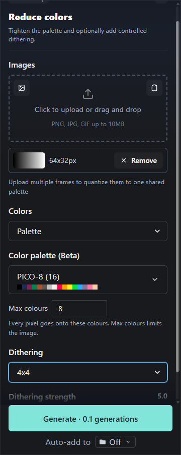

# PixelLab website review

Date: October 14, 2026. Live observations and public documentation are identified separately below. No credential values or authentication-storage contents are included in research evidence. The temporary browser profile stays under the ignored `.tmp` directory.

## Access and session diagnosis

The requested [reducer URL](https://www.pixellab.ai/create?tool=reduce_colors) initially redirected to sign in in Codex Browser. After manual sign in, the browser exposed Creator with an empty gallery and a Create S-XL image Pro tool summary, rather than the reducer. The user subsequently reported repeated returns to sign in. A later snapshot confirmed sign in with a redirect to the default creator tool.

Read only console inspection found `TypeError: Failed to fetch` in the terms status check, tier access checks, user tier fetch and cloud gallery fetch. This establishes failed service requests after the login attempt. It does not establish that cookies were deleted, that the access token expired, that the user was explicitly signed out, or which host failed. No request headers, cookies, token values or authentication storage were inspected.

One attempted Creator UI click was denied by automatic approval review because the frame was on Google's authentication origin. No Google account automation followed. The user was asked to complete authentication manually.

The regular-browser comparison uses the explicitly authorized Playwright fallback and an isolated temporary Edge profile. Installed Edge crashed under the restricted process launcher but launched successfully outside that restriction. The first Playwright launch used its default disabled Chromium sandbox; the user objected before signing in and that instance was closed. The replacement explicitly uses `chromiumSandbox: true`. Process inspection confirmed the replacement had no `--no-sandbox` flag and the earlier research instance was absent. Running outside Codex's process restriction does not require disabling Chromium's browser sandbox. All further browser tests must keep Chromium sandboxing enabled.

The user reported Google's “This browser or app may not be secure” rejection in the sandboxed replacement. [Google's official guidance](https://support.google.com/accounts/answer/7675428?hl=en) says it may reject embedded and software-automated browsers. Automation is therefore a plausible explanation for this later error, but does not establish the cause of the earlier service fetch failures and apparent session loss. No flags were changed to evade Google's check. The user subsequently completed email magic-link sign in manually in the sandboxed Edge profile, after which the reducer's authenticated controls were usable.

Only sanitized request hosts/paths/methods/statuses and selected reducer control state were retained by the fallback diagnostics. Authenticated control interactions, source upload and hex parsing were measured successfully; an attributable website-generated export was not obtained. The launch restriction, browser sandbox configuration, Google authentication rejection and website service-fetch failures are distinct observations. Every subsequent Playwright launch explicitly kept `chromiumSandbox: true`; the signed-in browser context was closed at the end of each test script.

Authenticated REST and MCP access works independently. This establishes that service credentials are usable, but does not establish that the browser's separate OAuth session is valid.

## Public website contracts

The [Reduce Colors documentation](https://www.pixellab.ai/docs/tools/reduce-colors) describes automatic reduction, explicit counts and a target palette. It names recommended Game Boy, PICO-8, NES and 1-bit palettes, Lospec link import, palette images and pasted hex colors. It describes per-image maximum counts, a shared choice across frames, and dithering restricted to the palette. It states a maximum image area of 512 by 512 pixels. The separate REST tests verified an area bound of 262,144 total pixels, including acceptance of a 1024×256 source; website boundary behavior remains unverified.

The [color options documentation](https://www.pixellab.ai/docs/options/color) distinguishes a weak generation palette preference from forced target colors. Automatic count, explicit count and supplied-palette reduction are separate operations. These controls do not imply the reducer and image generators expose the same fields.

The [dithering documentation](https://www.pixellab.ai/docs/options/dithering) lists pattern sizes 2 by 2, 4 by 4 and 8 by 8, plus strength. It does not identify the server's color distance or full algorithm. Live API tests provide output evidence in the separate API report.

## Completed authenticated website review

Live inspection completed after manual email sign in. Evidence is in `bench/palette-service-research/web-*`; screenshots are restricted to the reducer sidebar and exclude unrelated private gallery artwork. No authentication storage, cookies, bearer headers or unrelated gallery payloads were inspected or saved.

| Area | Live observation | Verification boundary |
|---|---|---|
| Source input | Upload/paste controls; PNG/JPG/GIF up to 10MB; multiple-file input; synthetic ramp preview explicitly 64×32px | Correct source preview dimensions verified; output dimensions unverified |
| Color selection | Auto detect / Number of colors / Palette | All three mode choices observed; explicit 8 selected during an earlier attempt |
| Target plus cap | Named PICO-8 with 16 swatches, Max colours set to 8; cap input min2/max64 and “No limit” placeholder | UI combination verified; successful runtime enforcement was not measured |
| Dithering | None / 2×2 / 4×4 / 8×8; strength defaults to 5.0 with Subtle/Strong endpoints | Selections and strength display verified; website output comparisons unavailable |
| Hex validation | `not-a-hex-color` displays “Needs at least 2 colours” | Verified inline validation; no generation submitted for malformed text |
| Hex parsing | Comma, space and newline separated four hex colors plus a duplicate become “Your colours (4)” / “4 colours” | Deduplication and mixed separators verified |
| Palette sources | Named presets, From Lospec, From a palette image, Paste hex colours | Source choices observed; Lospec fetching and palette-image extraction unverified |
| Shared frames | UI says multiple frames quantize to one shared palette; file input accepts multiple files | Website multi-frame processing not measured; separate REST evidence verifies shared palettes |
| Smart colors | No smart toggle in inspected reducer controls | Smart mapping is a separate interface capability; see API and extension evidence |

The menu contains 17 presets: 1-bit black/white (2), Game Boy (4), PICO-8 (16), NES (55), Commodore 64 (16), CGA (4), ZX Spectrum (15), Sweetie 16 (16), DawnBringer 16 (16), DawnBringer 32 (32), Endesga 32 (32), SLSO8 (8), Hollow (4), Oil 6 (6), Twilight 5 (5), AAP-64 (64), and Resurrect 64 (64). Counts are those shown by the website; the exact hex contents were not exported or independently checked here. `web-palette-menu.txt` preserves the observed menu.

The safe screenshot shows the synthetic 64×32 input, selected PICO-8, maximum 8 and 4×4 dither. The strength label shows 5.0; its slider lies partly under the fixed footer at this viewport, so the full control contract is also retained in `web-controls-final.json`.

### Generate attempts and output attribution

One earlier normal website attempt selected explicit eight colors and 4×4 dither. A gallery card appeared to show 32×32, but its ownership and downloaded dimensions were not established. This is **not evidence of a resize defect**.

Two subsequent fully loaded reducer-button clicks used the owned 64×32 synthetic ramp with PICO-8, a maximum of 8, 4×4 dithering and default strength 5. In the latter attempt, 12 seconds of scoped observation found no new matching synthetic-result image count (3 before, 3 after) and no attributable processing request. Only sanitized metadata for successful `check-terms`, `projects` and `creator/images` GETs was observed; response contents were not read. No output was downloaded because no new result could be identified safely and uniquely. There were no further Generate clicks after those attempts.

An additional import/diagnostic script encountered a normal menu visibility/stability timeout before reaching its planned final submit. It did not create another generation. This is an automation limitation, not a demonstrated server fault. The absence of a captured processing request does not establish why the button interaction failed to produce an attributable result, nor prove a persistent service defect.

Website billing is **unverified**: three normal Generate clicks were made across the review, each advertising 0.1 generations, but no attributable website charge was measured. They must not be silently added to the confirmed API/MCP usage total of 12.6 subscription generations. The earlier card's dimensions, strict palette membership, cap enforcement, alpha, preview/export parity, Lospec fetching, palette-image extraction and multi-frame website results remain explicit untested boundaries.

The website review is complete within these access and attribution limits. Live API/MCP measurements provide verified reducer outputs and Smart mapping results; website affordances alone are not treated as equivalent output evidence.
